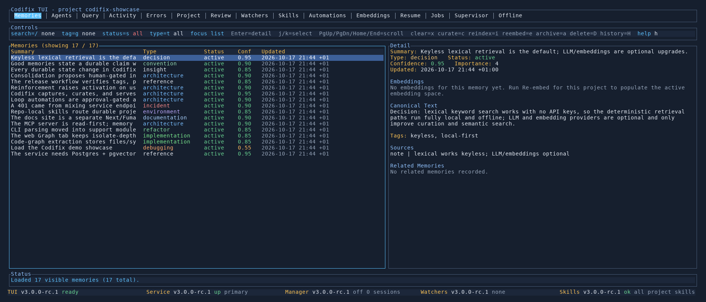

# Codifix

[](https://github.com/3vilM33pl3/codifix/actions/workflows/ci.yml?query=branch%3Amain) [](https://github.com/3vilM33pl3/codifix/actions/workflows/nightly.yml?query=branch%3Amain) [](https://github.com/3vilM33pl3/codifix/releases/latest) [](https://github.com/3vilM33pl3/codifix/releases/latest) [](https://github.com/3vilM33pl3/codifix/releases) [](https://codifix.dev/docs)

[](#license) [](Cargo.toml) [](https://github.com/3vilM33pl3/codifix/releases/latest) [](https://github.com/3vilM33pl3/codifix/releases/latest) [](https://github.com/3vilM33pl3/codifix/releases/latest) [](https://github.com/3vilM33pl3/codifix) [](https://github.com/3vilM33pl3/codifix/forks) [](https://github.com/3vilM33pl3/codifix/issues) [](https://github.com/3vilM33pl3/codifix/pulls) [](https://github.com/3vilM33pl3/codifix/commits/main) [](CITATION.cff)

Codifix is a local-first memory system for coding agents and developers.
It turns project work into durable, searchable knowledge, so the next Codex,
Claude, or human session can start with evidence instead of guesswork.

It captures what happened, curates what matters, stores it in PostgreSQL with
pgvector, and exposes it through a TUI, browser UI, and agent-friendly CLI.

[Website](https://codifix.dev) · [Documentation](https://codifix.dev/docs) · [v2.1.0](https://github.com/3vilM33pl3/codifix/releases/tag/v2.1.0)

The source tree is [v2.1.0](CHANGELOG.md). Windows packages are a preview of
client/operator functionality, not a complete native server stack. Use
`codifix urls` to inspect the configured application URLs.



## Start here

### Try it with Docker

The reproducible demo needs only Docker; it starts PostgreSQL with pgvector,
the service, and the web UI. Clone the repository and start the stack:

```bash
git clone https://github.com/3vilM33pl3/codifix
cd codifix
docker compose up
```

In a second terminal, load the demo project and ask one question:

```bash
docker compose exec codifix codifix demo
docker compose exec codifix codifix query --project demo --question "How does reinforcement work?"
```

Open `http://localhost:4040` for the browser UI, or run
`docker compose exec codifix codifix tui` for the terminal UI. Follow the
[Quickstart](https://codifix.dev/docs/quickstart) for the complete
demo path.

### Use it in a project

For a native installation, prerequisites, and verification, start with the
[Install guide](https://codifix.dev/docs/install) or download the
[v2.1.0 release](https://github.com/3vilM33pl3/codifix/releases/tag/v2.1.0).
Version 2 is a breaking upgrade from v1; existing users should follow the
[Update guide](https://codifix.dev/docs/install/update) before
restarting the service.
The setup wizard configures the machine once and the project you are working
in:

```bash
codifix wizard --global
cd /path/to/your-project
codifix wizard --dry-run
codifix wizard
codifix doctor
```

Native installations need a PostgreSQL database with pgvector; the install
guide covers local, hosted, Windows, and package-specific paths. The Windows
x86_64 MSI is per-user, installs under
`%LOCALAPPDATA%\Programs\Codifix`, and adds its `bin` directory to the
user `PATH`.

### Work with it every day

Capture finished work, query before making a change, resume after an
interruption, and inspect or recover when something looks wrong. The
[Daily workflow](https://codifix.dev/docs/daily-workflow) gives the
commands and the [TUI](https://codifix.dev/docs/tui) and
[Web UI](https://codifix.dev/docs/web-ui) make the stored evidence
easy to inspect.

### Connect agents

- [Codex Desktop plugin](https://codifix.dev/docs/codex-plugin) — the
  supported MCP connection and desktop workflow skill.
- [Agents](https://codifix.dev/docs/agents) — project setup and
  agent-facing workflows.
- [MCP](https://codifix.dev/docs/mcp) — read-only project-memory
  tools over stdio or local Streamable HTTP.

Use one Codifix MCP connection per client. The Codex plugin guide
explains how to avoid duplicate tool registration and how to verify the active
project.

## What it provides

- Cited answers from lexical, semantic, relation, and code-graph retrieval.
- Project memories with provenance, curation, review proposals, and durable
  re-entry briefings.
- Local TUI and browser UI for memories, activity, review, watchers, and
  runtime health.
- Coding-agent integration through the CLI, repo-local skills, and MCP.
- Repeatable evaluation with paired ablations, immutable artifacts, gates, and
  cost/latency reporting.

## Evidence and evaluation

The newest checked-in local reference is the
[2026-07-06 `memory-quality-v1` re-baseline](docs/developer/evaluation-runs/2026-07-06-memory-quality-v1-comparison.md):
`0.692` (18/26), with retrieval at 10/10 and grounded answers at 8/9. Its gate
is still red because the adversarial-stale floor is intentionally unmet; treat
it as a precise engineering reference, not a general release claim.

The separately recorded
[2026-05-03 Docker `memory-improvement-v1` benchmark](docs/developer/evaluation-runs/2026-05-03-memory-improvement-v1-full.md)
ran five paired repeats against a different suite. It reported full-memory
aggregate success from 0.0% to 18.1%, perfect retrieval ranking metrics, and a
41.2% reduction in total tokens. Read it as historical Docker-harness evidence
rather than a directly comparable successor to the July local run.

For methodology and commands, see the
[evaluation guide](https://codifix.dev/docs/evals) and
[CLI reference](https://codifix.dev/docs/reference/cli/eval).

## Documentation

The public site is organised with an essentials-first path and optional deep
dives:

- [Quickstart](https://codifix.dev/docs/quickstart)
- [Install](https://codifix.dev/docs/install)
- [Daily workflow](https://codifix.dev/docs/daily-workflow)
- [Help](https://codifix.dev/docs/help)
- [Operations](https://codifix.dev/docs/operations)
- [How it works](https://codifix.dev/docs/how-it-works)
- [CLI reference](https://codifix.dev/docs/reference/cli)

The [`docs-site/`](docs-site/README.md) directory contains the public site;
the [`docs/`](docs/developer/README.md) tree contains the detailed in-repository
manual and developer reference.

## Development and contributing

Start with [Contributing](CONTRIBUTING.md), the
[developer documentation](docs/developer/README.md), and the
[dev-stack guide](docs/developer/dev-stack.md). The development stack is
isolated from packaged installations; its setup and verification steps belong
in that guide rather than this README.

## License

Codifix is dual-licensed:

- **Open source:** GNU Affero General Public License v3.0 or later; see
  [LICENSE](LICENSE).
- **Commercial:** available under a separate commercial license; see
  [LICENSE-COMMERCIAL.md](LICENSE-COMMERCIAL.md).

Contributions are accepted under the repository's open-source license unless
explicitly agreed otherwise in writing. See [Contributing](CONTRIBUTING.md).
