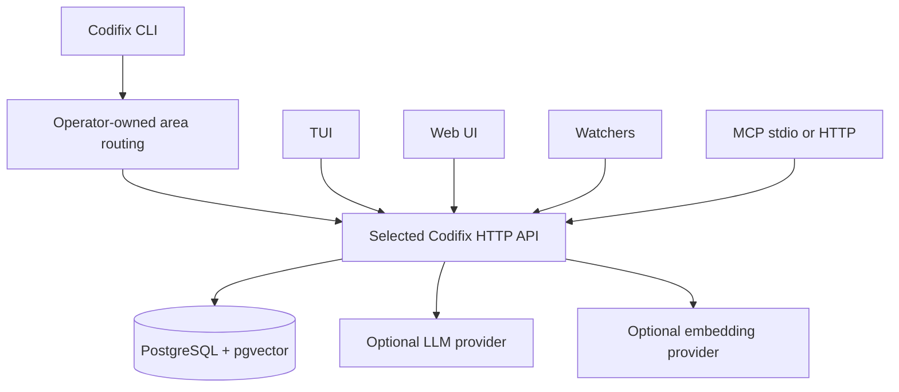

# Runtime topology

Each Codifix instance has its own service, database and configured authority.
The CLI, TUI, browser, watchers and MCP adapt to the selected instance. A single
installation can serve several projects; independently operated knowledge areas
do not become one unrestricted shared database.



## Components

| Component | Role |
|---|---|
| `codifix` CLI | Human and agent automation surface. |
| `codifix-service` | Local HTTP API, web UI host, curation pipeline, embedding jobs, MCP HTTP mount. |
| TUI | Terminal dashboard for humans reviewing memory, evidence, agents, and diagnostics. |
| Web UI | Web companion using the same service APIs as the TUI. |
| Watchers | Background processes that observe agent sessions and report activity. |
| MCP server | Read-first protocol adapter for MCP clients; it reuses the service API. |
| PostgreSQL | Durable store for projects, memories, captures, activities, history, graph data, and embeddings. |

Curation commits canonical changes and durable enrichment intents together.
Workers recover pending [jobs](/docs/reference/cli/jobs) from PostgreSQL after
restart. The offline write outbox and downloaded knowledge projections are
separate from the owning instance's canonical PostgreSQL state.

Private federation adds a separately configured gateway and publication/receiver
ledgers. It transports reviewed publications or explicit expertise requests;
ordinary local query does not automatically contact another area. See
[Federation and expertise](/docs/federation).

## Configuration layers

| Layer | Typical contents |
|---|---|
| Global config | Database URL, service URL, API token, providers, service preferences. |
| Area routing | Operator-owned mapping from exact repository/project identities to a service configuration and durable instance UUID. |
| Project config | Project slug, repo root, project-specific options. |
| Repo-local `.agents/` | Agent instructions and Codifix skills. |
| Runtime state | Checkpoints, service status, watcher heartbeats, generated logs. |

Do not commit secrets, API keys, database URLs, or local runtime state. Repo-local project identity and agent instructions are normally safe to commit after review.

## Service ports and modes

Packaged installs normally run the service in the background through systemd on Linux or launchd on macOS. Development runs use the foreground command:

```bash
codifix service run
```

The foreground command should keep running in the terminal and should not daemonize itself. If you need background operation, use the packaged service manager.

## MCP as an adapter

The built-in MCP server exposes ordinary read-only memory tools alongside
separately gated loop and expertise actions. Expertise submission sends an
explicitly authorized question externally; it is not ordinary retrieval.
Stdio runs as a local process; service-mounted HTTP uses scoped token
authentication. See [MCP](/docs/mcp) for the transport and disclosure boundaries.

## Operational rule

When something looks wrong, check the layers in order:

```bash
codifix doctor
codifix health
codifix status --project <project-slug>
```

Then inspect the TUI Errors tab, service logs, watcher status, and embedding diagnostics.
