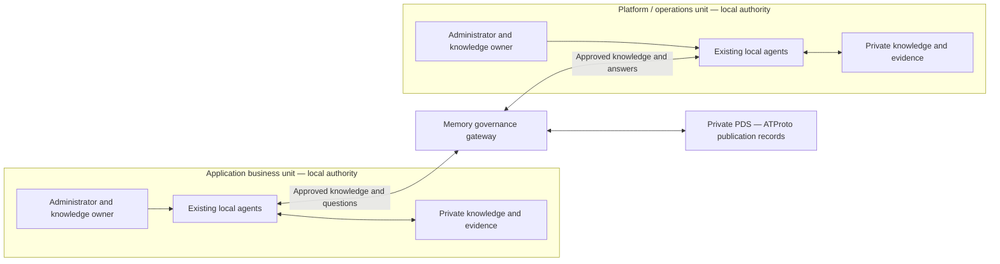

# M1 — Commercial foundation for the Agentic Enterprise

Date: 2026-09-15. Owner: founder (Olivier). Status: preparation pack; commercial
hypotheses await customer discovery. Completion evidence is maintained in the
[M1 execution record](m1-execution.md). See the
[financial and pitch appendix](m1-finance-pitch.md) for economic inputs, narrative,
demonstration and claim evidence.

Published business summary:
[M1 — Agentic Enterprise commercial preparation](https://app.notion.com/p/3dc8990715f4815a812bf2a9262ef282),
under the existing Codifix pitch workspace. The repository dossier is the detailed
source of truth; the Notion page is its business-facing summary.

## 1. Decision and product definition

**Codifix is positioned as the knowledge and governance network for the Agentic
Enterprise.** Each business unit controls its knowledge, administrators and local
agents. Authorized relationships allow selected expertise to cross unit
boundaries while the underlying systems remain independently controlled.

This is the founder-approved commercial direction, not a claim that autonomous
enterprise operation or customer ROI has been demonstrated. The first proposed
proof is **IT incident handover between application and platform/operations
business units**, integrating existing agent runtimes through supported local
interfaces. [Technical evidence and limits](m1-finance-pitch.md#claim-to-evidence-register)
remain separate from this positioning.

### Network vocabulary

| Term | Meaning in the commercial model | First-pilot interpretation |
| --- | --- | --- |
| Vertex | Independently governed organizational knowledge domain with accountable humans, local knowledge and its own agents | One business unit represented by a separately administered Memory instance; separate database, credentials and local authorization |
| Local agents | Assistants operating within that unit's existing runtime, tools and human authority | Application and platform assistants use permitted knowledge; people authorize and perform operational actions |
| Edge | Explicitly authorized knowledge/expertise collaboration between vertices | Approved sharing and recipient/output policy through a private Memory space/gateway; an edge is a logical relationship, not a promise of direct peer-to-peer transport |
| Knowledge | Owned, versioned claims with selected evidence, attribution and review | Incident procedures, constraints and reviewed corrections; raw incident archives remain local unless explicitly selected |
| Governance | Decisions about who may publish, read, ask, answer, correct and forward material | Local grants intersect gateway/collection policy; source owners approve changes |
| AT Protocol | External identity/record/repository foundation underneath knowledge federation | Published knowledge and capability advertisements use the ATProto adapter; private Q&A uses Memory's separate gateway mailbox |

The diagram is a conceptual pilot topology. It does not assert arbitrary-runtime
compatibility, a separate PDS per unit, or that private questions enter the PDS.
See [ADR 0011](../../developer/adr/0011-atproto-federation-adapter.md) and the
[F1 contract](f1-execution.md).

### Buyer, value and expansion hypotheses

| Role | Proposed accountability | Evidence to seek in discovery |
| --- | --- | --- |
| CIO / CTO / technology-operations leader | Economic buyer; budget and value decision | Named budget route, spending authority, procurement process and decision date |
| Application-unit leader | Operational champion and first workflow owner | Recent handovers, service ownership and responder access |
| Platform/operations leader | Second champion and expert-time owner | Escalation burden, repeat questions and approved expertise |
| Separate unit administrators | Control their own instance, identities and grants | Named people with independent authority and an access-isolation demonstration |
| Knowledge owners and reviewers | Approve shareable evidence and corrections | Time allocation, review rules and freshness expectations |
| Security/privacy and service owner | Approve data boundary and deployment | Approved recipients, model destinations, retention and recovery requirements |
| Analyst and buyer finance partner | Own measurements and value calculations | Baseline access, loaded labor rates and explicit cash-realization assumptions |

The proposed value is faster cross-unit diagnosis, fewer repeated expert
interruptions, and correct reuse of reviewed knowledge. These are hypotheses to
measure, not guaranteed improvements. Initial expansion would add services and
units with similar handovers, then acquired entities and external partners after
evidence and separate authorization. Expansion potential does not justify
extrapolating one pilot's results across an enterprise.

### Decision history and scope

The founder's approved M1 plan on 2026-09-15 replaces the initial **centralized
enterprise memory** pitch and prioritizes enterprise business units ahead of the
earlier engineering/MSP-first assumption. Engineering remains the first workflow
domain. MSP, customer/supplier, acquired-entity and game QA/support cases remain
later discovery alternatives. Historical material is retained as context:
[pitch workspace](https://app.notion.com/p/3b38990715f48127970accded279fa63) and
[earlier QA/support proposal](https://app.notion.com/p/3b38990715f481839a1eec7ff9579b8d).

Codifix owns knowledge and governance and integrates existing agents; M1 does not
add an agent runtime, execution authority, connectors or F2 delegation. It does
not execute interviews, contact prospects, agree prices or deploy customer
systems. M2–M4 build on this preparation; M5 obtains real customer evidence.

## 2. Qualification: three separate decisions

Use **discovery priority**, **pilot qualification** and **deployment readiness**
as separate fields. A high score never overrides a failed prerequisite or a
technical release gate. An unknown is unresolved, not a negative factual finding.

### Buyer scorecard

Each dimension scores 0–2. **0 = unsubstantiated, 1 = plausible, 2 = supported by
reviewable evidence.** A contradicted assumption also scores 0, with the conflict
recorded explicitly. A verbal claim alone normally scores 1. Link evidence by
reference without copying sensitive customer content into this public repository.

| Dimension | 0: unsubstantiated | 1: plausible | 2: evidence-supported |
| --- | --- | --- | --- |
| Recurring pain | No specific recurring handover established | Participants describe repeated handover problems | Dated representative incidents demonstrate recurrence in a stated window |
| Measurable operational cost | No attributable delay or labor basis | Estimated delay or expert workload | Sample timings/time logs with volume, roles and loaded-rate provenance |
| Need for independent control | No demonstrated reason for separate authority | Different owners or systems suggest a boundary | Administrators and policy artifacts establish separate control and permitted exchange |
| Sponsor / budget access | No sponsor or budget route | Champion identifies a plausible buyer | Named economic buyer confirms decision process, budget route and owner commitments; no contract is implied |
| Measurement feasibility | No accessible baseline or assessable cases | Cases and assessors appear obtainable | Approved comparable cases, measurement owners and an assessment method are available |
| Expansion potential | No adjacent repeatable problem | An additional unit/workflow is suggested | Its owner confirms the same dependency with examples; this is not committed revenue |

Total = sum of six dimensions, maximum 12. **9/12** is the provisional internal
discovery-priority hypothesis, approved for this pack; it has no validated
predictive power. Below 9 means collect missing evidence or deprioritize, not
that the product cannot help. At or above 9 means prioritize further discovery,
not permission to run a pilot.

### Mandatory pilot prerequisites

Record each as PASS / FAIL / PENDING with an evidence reference, owner and date.
All must pass before declaring a prospect pilot-qualified. Until reviewed,
deployment readiness remains PENDING even for a qualified pilot.

| ID | Prerequisite | Required evidence / accountable role |
| --- | --- | --- |
| Q1 | Two independently administered instances | Separate DBs, credentials and local authorization; named administrators on both sides, no shared omnipotent operator masquerading as independence / unit administrators |
| Q2 | Named owners and economic sponsor | Economic buyer, application and platform owners, reviewers, analyst and time commitments / founder and buyer |
| Q3 | Approved sharing boundary | Selected sources/versions, permitted recipients, grants, question/output destinations, human review and retention rules / both knowledge owners and security lead |
| Q4 | Observable baseline and comparison | Accessible eligible cases, historical snapshots, current handover/search workflow and comparator resources / analyst |
| Q5 | Agreed charter | Signed-off metric thresholds, observation windows, minimum comparable case counts, exclusions, stop rules and cost ceilings / buyer, workflow owners and analyst |

Technical admission requires the applicable R3/P/G evidence in the
[roadmap](README.md#sequence-ownership-and-mandatory-release-gates), together with
customer-specific identity/access, transport isolation, review-byte attribution,
revocation, recovery/stale-writer, model-egress and operational checks. The
platform/security lead records PASS / FAIL / PENDING per gate and its evidence.
M1 supplies this admission contract; current controlled engineering evidence is
not a customer release approval.

### Blank qualification record — copy per prospect

Use an approved private customer workspace for completed records. PENDING is an
unfilled value, never zero cost, consent or a promise.

| Field | Value to complete | Evidence / owner / date |
| --- | --- | --- |
| Record ID, organization, units, workflow and observation window | PENDING | Founder / PENDING |
| Economic buyer, application champion, platform champion | PENDING | Founder / PENDING |
| Administrator A / B and knowledge reviewers A / B | PENDING | Unit leaders / PENDING |
| Existing agent runtimes, models, tools and operational approval rules | PENDING | Unit administrators / PENDING |
| Pain score / cost score / control score | PENDING / PENDING / PENDING | Link evidence for each / PENDING |
| Sponsor score / measurement score / expansion score | PENDING / PENDING / PENDING | Link evidence for each / PENDING |
| Total / 12 and discovery priority | PENDING | Analyst; unresolved scores treated as 0 only when producing a labelled provisional total |
| Q1 / Q2 / Q3 / Q4 / Q5 | PENDING / PENDING / PENDING / PENDING / PENDING | Reference each approval separately |
| Pilot-qualified decision and rationale | PENDING | Founder and buyer / PENDING |
| Technical admission gates and evidence | PENDING | Platform/security lead / PENDING |
| Deployment-ready decision | PENDING | Authorized release owner / PENDING |
| Open assumption, next evidence request, owner and due date | PENDING | One row per unresolved question |
| Procurement, buying timeline and data access constraints | PENDING | Buyer / PENDING |

### Discovery interview guide

Proposed format: 45–60 minutes with both operational champions; a separate buyer
and security discussion if their authority is absent. Duration is a scheduling
assumption. Ask for concrete recent examples before presenting expected benefits.

| Question / prompt | Evidence request | Score or gate informed |
| --- | --- | --- |
| Walk through the last three incidents handed from application to platform. Where did each wait? | Dated, redacted incident timeline and service/severity tags | Pain, cost, Q4 |
| Which questions recur, and who gets interrupted? How long do explanations take? | Representative interruption/time logs, with contributor consent | Pain, cost |
| Show how the same handover is handled today. What already works? | Runbooks, handover documents, search and existing agent workflow | Measurement, Q4 |
| Why must these units retain separate control? Who can grant and revoke access on each side? | Admin/authority map and access policy | Control, Q1 |
| What may cross the boundary, to whom, and which model or output destination can receive it? | Approved source/recipient/egress matrix; retention requirements | Q3 |
| Who decides an answer is correct and a correction is authoritative? | Rubric, owner and review workflow; source version examples | Measurement, Q2–Q4 |
| Which cases can be replayed without exposing future resolution knowledge? | Incident-time snapshots, matched cases and responder assignments | Measurement, Q4 |
| Who funds this, what evidence would justify a purchase, and what would stop it? | Buyer-confirmed budget route, procurement and decision process | Sponsor, Q2/Q5 |
| What onboarding, review and support effort can both units sustain? | Staff allocation and maximum time/cost tolerances | Cost, Q2/Q5 |
| Which next unit has the same problem, and what does its owner say? | Owner interview or dated examples, without assuming a commitment | Expansion |
| Which results would count as failure or be too uncertain to act on? | Locked thresholds, sample minimums, exclusions and stop rules | Q5 |

End with an evidence-request list and owners; do not convert interview estimates
into observed results. Record counterevidence and reasons to prefer the existing
workflow, as well as positive signals.

### Fictional worked example — not a prospect or pilot result

**ExampleCo** and all facts below are invented solely to exercise this scorecard.
Its application and platform units report repeated cache-configuration handovers.

| Dimension | Illustrative evidence | Score |
| --- | --- | --- |
| Pain | Fictional dated sample contains recurring incidents | 2 |
| Cost | Fictional time logs identify expert minutes; rate validation pending | 1 |
| Control | Fictional unit administrators have separate credentials and authority | 2 |
| Sponsor | Champion suggests a CTO sponsor; CTO has not confirmed | 1 |
| Measurement | Fictional approved replay sample and assessor identified | 2 |
| Expansion | A third unit is suggested; owner has not confirmed | 1 |
| Total | Fictional evidence, no market inference | **9/12** |

Decision: prioritize discovery. Q2 is PENDING because the economic sponsor has not
confirmed; Q3/Q5 require actual approvals. The organization is **not
pilot-qualified**, and technical admission remains PENDING. A score above 9 does
not bypass these requirements. The positive variant in the execution record
supplies all prerequisites and still keeps deployment readiness separate.

## 3. Pilot charter — copy and agree before execution

### Workflow and authority

1. The application team accepts/records an eligible incident handover and asks a
   scoped question using its existing assistant.
2. Permitted expertise is discovered; the requester reviews the exact question,
   responder and output/model destination before submission.
3. The platform-side service returns a bounded cited answer from eligible,
   reviewed knowledge. Permission denial, uncertainty, expiry or unavailability
   are recorded outcomes, not silently retried into apparent success.
4. The responsible human evaluates the answer and authorizes/performs the next
   operational action under existing controls. M1 introduces no remote execution.
5. A proposed correction is reviewed at its origin. E approval advances shared
   knowledge but does not automatically rewrite the origin's ordinary local source.
6. A later eligible case explicitly retrieves/cites the corrected shared version.
   If the demonstration instead uses F1 to answer again, the origin first curates
   the corrected local source and renews the collection review. Record these as
   additional human steps, with their cost; changed frozen entries are otherwise
   ineligible. [E semantics](2026-09-09-e-completion.md), [F1 contract](f1-execution.md).

### Charter fields and illustrative schedule

| Field | Required entry before pilot execution |
| --- | --- |
| Units, named owners, environments and data classification | PENDING — customer-specific; complete qualification record |
| Included services, incident classes, eligibility and exclusions | PENDING — predeclare before observing results |
| Existing workflow and permitted source snapshot | PENDING — same information availability for comparison |
| Agent runtime/model/version/tool budget and human authority per arm | PENDING — hold comparable or document differences |
| Minimum matched cases per arm and correction-reuse opportunities | PENDING — analyst justifies feasibility from incident frequency; buyer agrees |
| Observation deadline, handling of unresolved incidents and crossover | PENDING — lock before assigning cases |
| Success thresholds for every metric, non-inferiority margin for quality | PENDING — buyer/assessor sign off; no universal default benefit percentage |
| One-time onboarding ceiling and recurring cost ceiling | PENDING — buyer and finance partner approve |
| Stop rules and named restart authority | Confirmed unauthorized disclosure/action stops pilot and triggers security review; other quality/cost thresholds PENDING |
| Measurement retention, evidence store/access and deletion date | PENDING — security and analyst approve before collection |
| Sign-off names, date and charter version | PENDING — both unit owners, buyer, analyst and security/release owner |

Illustrative eight weeks, measured from readiness and charter approval rather
than today's date: weeks 1–2 establish baseline and instrument both units; weeks
3–6 run assisted operation and matched comparisons; weeks 7–8 reconcile quality,
costs, correction reuse and the buyer decision. An eight-week calendar does not
override inadequate case counts or technical prerequisites. Separate synthetic
replay from live observations in every report.

### Measurement dictionary

Owner abbreviations: **AN** analyst; **IR** independent incident assessor;
**UL** unit leads; **KO** knowledge owner/reviewer; **AD** administrators;
**FP** finance partner; **SL** security lead. Each threshold below is deliberately
unfilled; M5 collects and signs it before execution.

Let **N** be all eligible assigned handovers in an arm, including refusal, denial,
expiry, failure and abandonment. Report N, observation window and matched strata
beside every statistic. Answer exchanges have their own denominator **E**, the
number of unique submitted requests, including rejected submissions. Preserve
request identity across retries (use a local measurement ID if submission never
receives a service ID); retries consume resources but do not inflate E. Record
pre-submission denials/abandonment separately and retain their handovers in N.
Multiple questions do not turn one incident into multiple completed handovers.

| ID / measure | Definition and denominator | Evidence source | Owner | Customer-agreed threshold |
| --- | --- | --- | --- | --- |
| T1 First correct action | Minutes from receiving unit accepting handover to first action judged correct and actionable; median/p90 on observed events plus event count/N and unresolved count/time censored at deadline | Incident timestamps, redacted action evidence and blinded rubric review | AN + IR | PENDING minutes or reduction, coverage and censoring tolerance |
| T2 Accepted resolution | Minutes from handover acceptance to human-accepted resolution; same event/censoring reporting as T1; unresolved cases never assigned zero duration | Ticket timeline, acceptance and external-wait tags | AN + IR | PENDING minutes or reduction and resolution coverage |
| X1 Expert interruptions | Distinct unplanned expert context switches / N; repeated clarifications count, message count alone is insufficient | Consented interruption log with case and expert reference | UL + AN | PENDING interruptions per case or reduction |
| X2 Expert time | Sum of expert active minutes, including unsuccessful work and review / N; report interruption subset separately | Disjoint activity/time log | UL + AN | PENDING minutes per case or reduction |
| L1 Correction reuse | Later eligible cases correctly applying the approved correction / all later cases where that correction was relevant; report numerator/denominator and reviewed version | Correction provenance, relevance decision and blinded later-case assessment | KO + IR | PENDING reuse rate and minimum eligible opportunities |
| L2 Error recurrence | Later eligible cases repeating the corrected error / same eligible-opportunity set as L1 | Versioned evidence and assessor's error labels | KO + IR | PENDING maximum recurrence rate |
| O1 Unit onboarding | Elapsed time from unit's agreed onboarding start to admission/first permitted use; active hours separately for each unit, including failures; report units completed/attempted | Admin task/time log and admission record | AD | PENDING time/hours ceiling per unit |
| O2 Collection onboarding | Elapsed time and active review/curation hours from collection preparation start to reviewed activation; collections completed/attempted, including unsuccessful work | Source inventory, review and activation records | KO | PENDING time/hours ceiling per collection |
| C1 Operating cost | Total attributable operating spend and valued labor / observation period; cost/N and cost/useful completed handover, with total spend and completion count | Provider usage/invoices, infrastructure allocations and disjoint time log | FP + AN | PENDING total and per-useful-case ceiling |
| QL1 Correctness | Correct answers / all assessable delivered answers; also correct answers / E and unassessable/delivered coverage; wrong, stale and unsupported answers separately | Blinded assessor rubric and minimized answer/citation snapshot | IR | PENDING minimum correctness and baseline non-inferiority margin |
| QL2 Useful completion | Handovers meeting agreed correct-and-useful rubric / N, regardless of how many attempts occurred | Accepted action/resolution plus assessor judgment | IR + AN | PENDING minimum rate and change versus baseline |
| QL3 Refusal/failure | Mutually exclusive refused, denied, expired, failed, cancelled/abandoned or completed exchanges / E, plus pending/uncertain-at-cutoff / E so all exchanges reconcile; split justified refusals from avoidable ones | Sanitized outcome ledger and requester observation | AN + SL | PENDING tolerances by category; never optimize away warranted denial |
| QL4 Disclosure | Exchanges with confirmed inappropriate disclosure / E plus absolute event count and case-level affected count/N; report suspected/pending separately | Approved-boundary matrix and security review | SL | Zero confirmed events for a successful pilot; customer confirms incident handling and stop/restart rules |

Overall incident MTTR is secondary context, because upstream dependencies and
outages may dominate it. T1/T2 measure from a locked handover event; neither proves
that Codifix caused an entire incident's resolution. Human active time is recorded
separately from waiting time. If a denominator is zero, report **N/A**, not 0% or
100%; missing evidence is PENDING/unassessable, not a favorable outcome.

### Evidence collection and comparison controls

Use three linked, access-controlled records. This is a measurement template, not
a new product API or an instruction to expand raw capture.

| Record | Fields to capture |
| --- | --- |
| Case ledger | Pseudonymous case ID, arm, synthetic/replay/live label, eligibility, severity, service, novelty, responder familiarity, dependency count, assignment/time window, handover/action/resolution timestamps, external waits, unresolved state, runtime/model/tool budget, rubric result and minimal evidence reference |
| Exchange / correction ledger | Case/exchange ID, permitted collection/version and destinations, submitted/terminal timestamps and outcome, correct/incorrect/unassessable label, citation/version references, correction approval/version, later-case relevance/reuse/error judgment, denied or suspected disclosure reference |
| Effort / cost ledger | Case or shared activity ID, actor role, disjoint activity category, minutes, loaded-rate reference, onboarding versus recurring, invoice/usage unit, deployment allocation, evidence date and owner |

The current F1 contract expires Q&A payloads after 24 hours and metadata after
30 days. The analyst must arrange an approved minimal assessment record before
expiry, without extending product retention or broadly archiving sensitive
answers. Record consent, allowed content, access and deletion dates in the
charter. If correctness cannot be assessed from approved retained evidence, label
it unassessable. [F1 retention contract](f1-execution.md).

- Compare current handover documents/search (including simpler retrieval) with
  Codifix at equivalent information and recorded resource budgets. Give the
  baseline the relevant approved curated information; do not manufacture a gain
  by hiding it. This follows the [R3 comparison requirement](README.md#core-reliability-evaluation-retrieval-and-expert-correction).
- Match or stratify severity, affected service, novelty and responder familiarity;
  tag external dependencies. Freeze incident-time sources so future resolutions
  cannot leak into earlier cases. Use held-out incident variants for later
  correction reuse.
- Counterbalance replay order or use different responders; an engineer solving
  the same incident twice has a learning advantage. Record runtime/model changes
  and new tool authority as confounders, not Codifix benefit.
- Retain every assigned case in a disposition table. Report performance on matched
  cases and the unmatched/excluded counts with predeclared reasons. Keep failures
  and inconclusive cases visible in total completion and cost results.
- Lock the rubric, observation window, exclusions, sample minimums and thresholds
  before execution. A reviewer who did not produce the answer assesses correctness,
  blinded to the arm where feasible; record unavoidable unblinding.
- Report descriptive estimates with sample sizes and uncertainty. Small or
  non-random before/after samples do not justify causal or enterprise-wide ROI
  claims. Missing thresholds, inadequate comparable cases, insufficient reuse
  opportunities or unassessable quality yield **INCONCLUSIVE**, not success.

## 4. Outputs, decisions and handoffs

The result template has five separate fields: discovery priority; pilot
qualification; technical readiness; measured pilot outcome (PASS / FAIL /
INCONCLUSIVE); commercial conversion decision. Each needs owner, date and linked
evidence. A successful technical exercise does not imply commercial conversion.

| Milestone | M1 handoff | Work still required |
| --- | --- | --- |
| M2 | Consistent product boundary, workload, adoption and value assumptions | Inspect/rebuild London and New York models; reconcile ACV versus usage, retention, cohorts, cash and funding cases |
| M3 | Complete delivery-cost register and packaging hypotheses | Validate provider/deployment/support costs and pricing; stress delays and margins; revenue remains gated on readiness |
| M4 | One-page narrative, two-unit storyboard and claim evidence | Revise actual deck/startup materials, verify current competitors, reconcile measured/planned evidence and funding milestones |
| M5 | Scorecard, interview guide, charter, collection templates and threshold fields | Founder-led discovery, actual approvals/agreements, qualified two-party deployments, measurements and conversion decisions |

The companion [financial and pitch appendix](m1-finance-pitch.md) is part of this
dossier. [M1 execution evidence](m1-execution.md) records tabletop validation and
publication. No customer-specific field in this pack is prefilled as an observed
fact, and M1 completion does not close customer-readiness or remaining roadmap gates.
